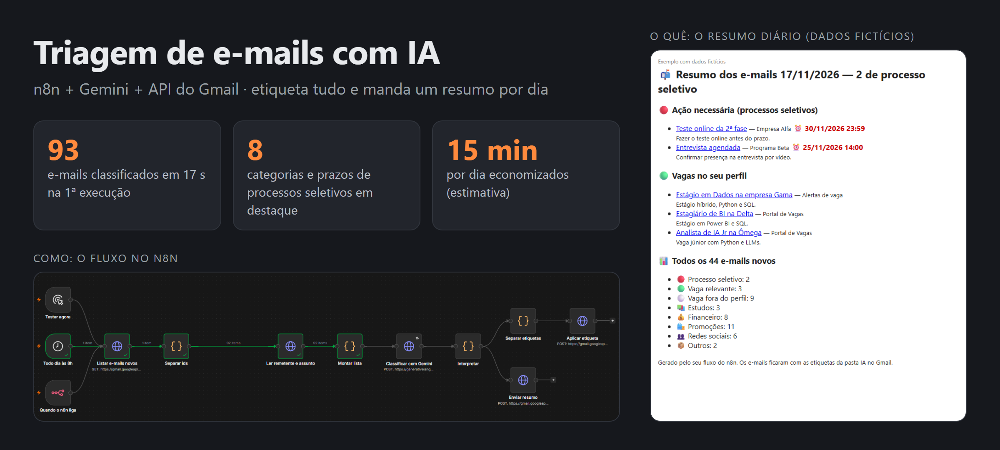
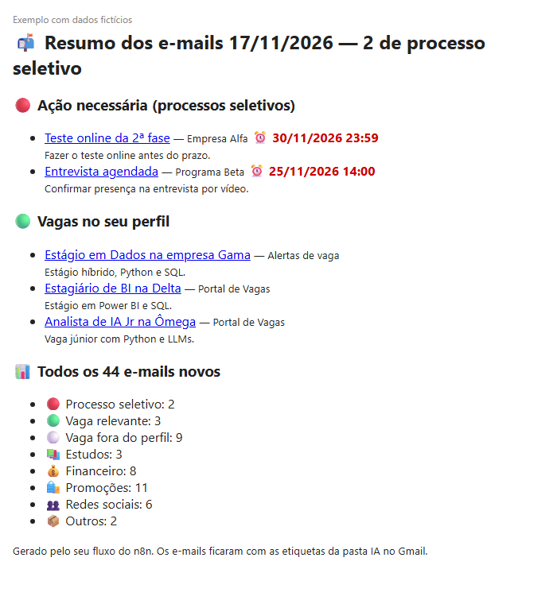
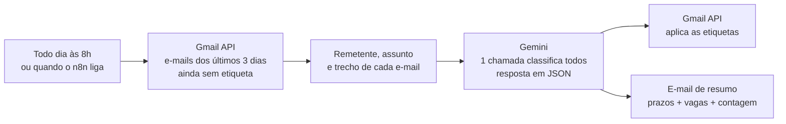

# Triagem de e-mails com IA | n8n + Gemini + Gmail



Automação que organiza o meu Gmail sozinha: classifica cada e-mail novo em 8 categorias, coloca etiquetas e me manda **um resumo por dia** com o que importa: prazos de processos seletivos e vagas no meu perfil.

## O problema

Recebo cerca de **40 e-mails por dia**: alertas de vagas (a maioria fora do perfil), promoções, bancos, redes sociais. No meio disso ficavam os e-mails que importam de verdade: etapas de processos seletivos com prazo. Eu gastava **uns 15 minutos por dia** procurando esses e-mails, e mesmo assim corria o risco de perder um prazo.

## O resultado

- Na primeira execução, **93 e-mails** dos últimos 3 dias foram classificados e etiquetados em **17 segundos**.
- Todo dia chega um resumo com os prazos de processos seletivos, as vagas no meu perfil e a contagem por categoria (prévia na imagem do topo).

  <details>
  <summary>Ver o resumo de exemplo em tamanho maior (dados fictícios)</summary>
  <br>
  
  </details>

- **Tempo economizado (estimativa):** 15 min/dia, cerca de 1h45 por semana ou 90h por ano. O n8n soma esse valor a cada execução no painel *Time saved*.

## Como funciona



| Etiqueta | O que entra |
|---|---|
| 🔴 Processo seletivo | processos em que já me inscrevi: testes, entrevistas, resultados (com prazo extraído) |
| 🟢 Vaga relevante | vaga específica de estágio/júnior em dados, BI, IA ou desenvolvimento |
| ⚪ Vaga fora do perfil | vaga específica de outra área |
| 📚 Estudos | faculdade, cursos, certificados |
| 💰 Financeiro | bancos, faturas, cobranças |
| 🛍️ Promoções | ofertas, newsletters, marketing (inclusive de sites de vagas sem vaga específica) |
| 👥 Redes sociais | notificações que não são vagas |
| 📦 Outros | o resto |

### Decisões de projeto

- **Uma chamada ao Gemini por execução**, com todos os e-mails juntos e `responseSchema`. A resposta já vem em JSON válido, com categorias de uma lista fechada, e cabe com folga no plano gratuito.
- **Não reclassifica:** e-mails que já têm uma etiqueta da pasta IA são ignorados. Se o PC ficar desligado, a próxima execução pega o que ficou para trás (até 3 dias).
- **Nada é apagado nem arquivado.** O fluxo só adiciona etiquetas.
- **Proteção contra instruções escondidas:** o conteúdo dos e-mails vai para o modelo como dado JSON, com a ordem de ignorar qualquer instrução escrita dentro deles. Na pior das hipóteses, um e-mail malicioso só consegue mudar a própria etiqueta.
- **Limite da API do Gmail respeitado:** as leituras vão em lotes de 20 por segundo.
- **Ajuste com dados reais:** na primeira execução, e-mails de marketing de sites de estágio caíram como "vaga relevante". A regra foi reescrita para exigir uma vaga específica (cargo e empresa).

## Como usar no seu Gmail

1. **n8n:** instale e rode localmente (`npx n8n` ou `npm install -g n8n`; use Node 20 ou 22).
2. **Google Cloud:** crie um projeto, ative a **Gmail API**, configure a tela de consentimento (público externo, você como usuário de teste) e crie um cliente OAuth do tipo *Aplicativo da Web* com o redirecionamento `http://localhost:5678/rest/oauth2-credential/callback`.
3. **Credenciais no n8n:** crie uma *Gmail OAuth2 API* (com o ID e o segredo do passo 2) e uma *Google Gemini(PaLM) Api* (com a chave gratuita do [Google AI Studio](https://aistudio.google.com/apikey)).
4. **Etiquetas:** crie no Gmail as 8 etiquetas e pegue os ids delas (`GET https://gmail.googleapis.com/gmail/v1/users/me/labels`). Troque os ids no dicionário `ETIQUETAS` de [`gerar_fluxo.py`](gerar_fluxo.py).
5. **Gerar e importar o fluxo:**
   ```bash
   EMAIL_RESUMO=voce@gmail.com python gerar_fluxo.py
   n8n import:workflow --input=organizar-emails.json
   ```
   Ou importe pelo editor do n8n: *Import from file*. Abra o fluxo, escolha as duas credenciais nos nós e clique em **Publish**.

O fluxo fica em [`organizar-emails.json`](organizar-emails.json) e é gerado por [`gerar_fluxo.py`](gerar_fluxo.py). O script existe para manter o código JavaScript e o prompt legíveis e versionados, em vez de editar tudo dentro do editor do n8n.

## Limitações conhecidas

- Roda no meu PC: só funciona com o computador ligado e o n8n aberto.
- Até 100 e-mails por execução; o resto fica para a próxima.
- Com o app OAuth em modo de teste, o Google pede login de novo a cada 7 dias. Para uso contínuo, é preciso publicar o app.
- **Privacidade:** remetente, assunto e um trecho de até 300 caracteres de cada e-mail são enviados ao Gemini. No plano gratuito, o Google pode usar esses dados para melhorar os modelos dele.

## Tecnologias

n8n 2.x · Google Gemini (gemini-3.5-flash-lite) · Gmail API · JavaScript (nós Code do n8n) · Python (gerador do fluxo)
